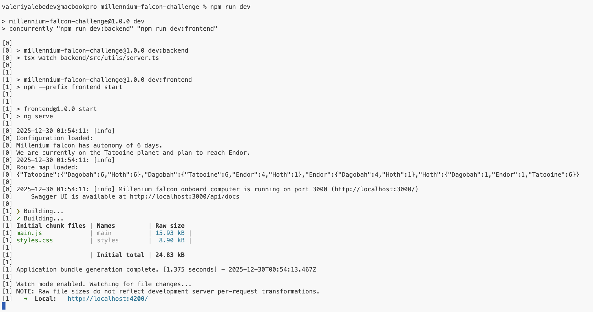
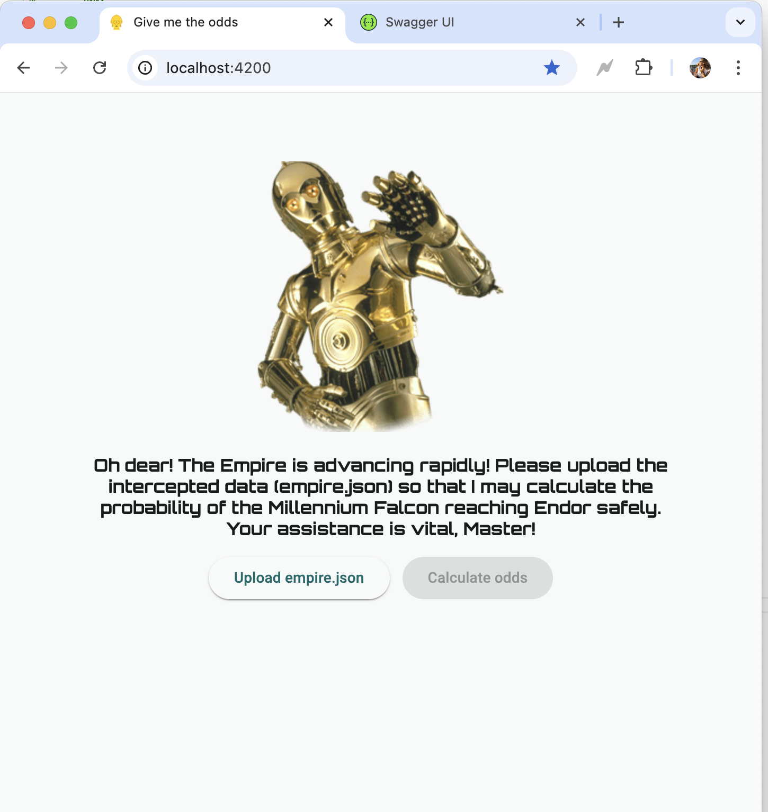
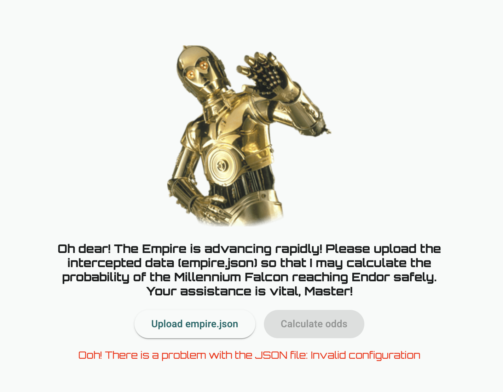
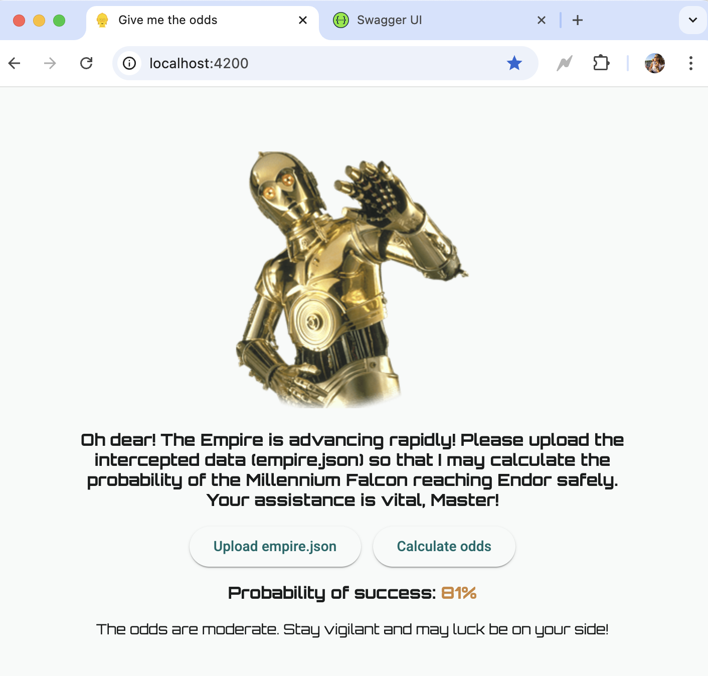
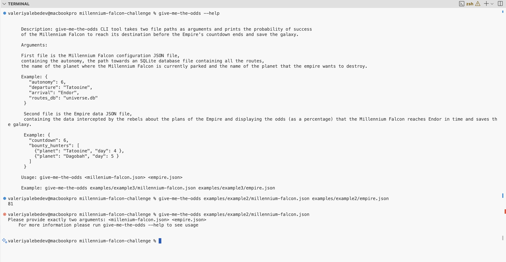
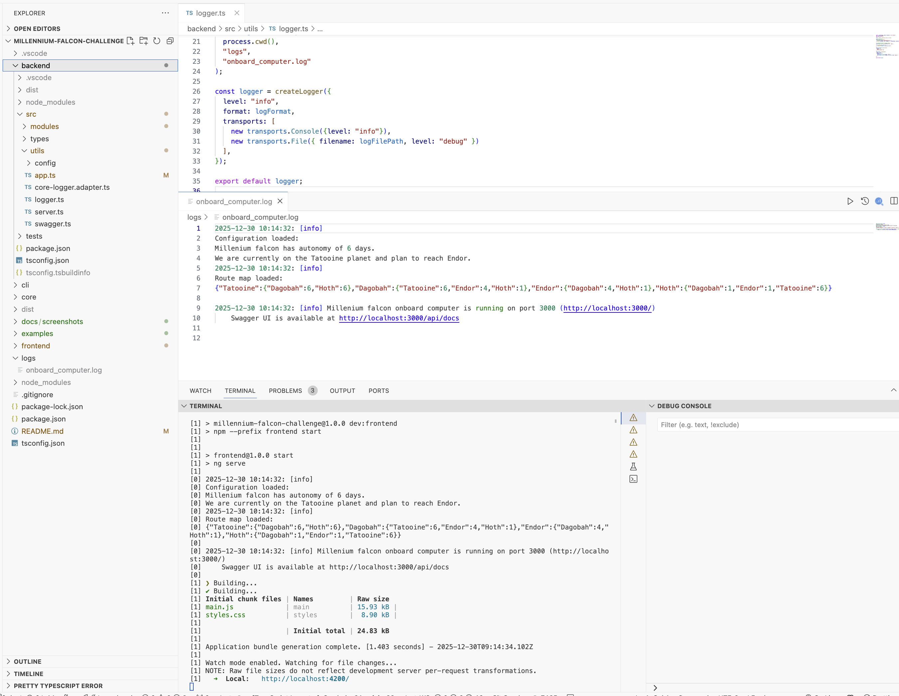
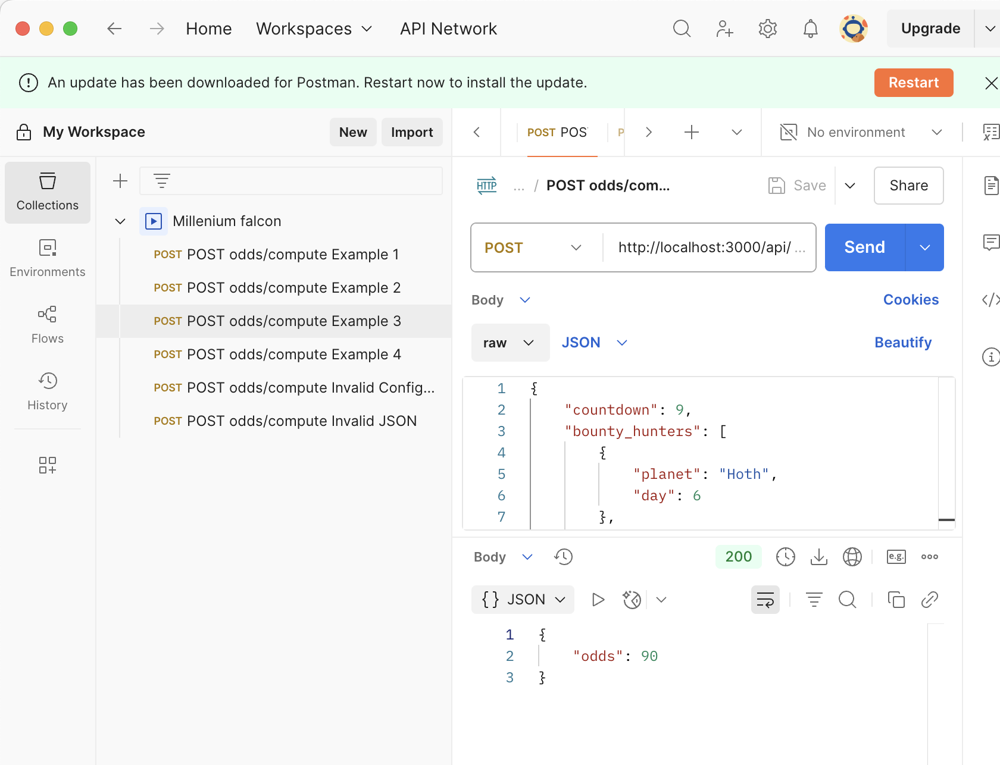
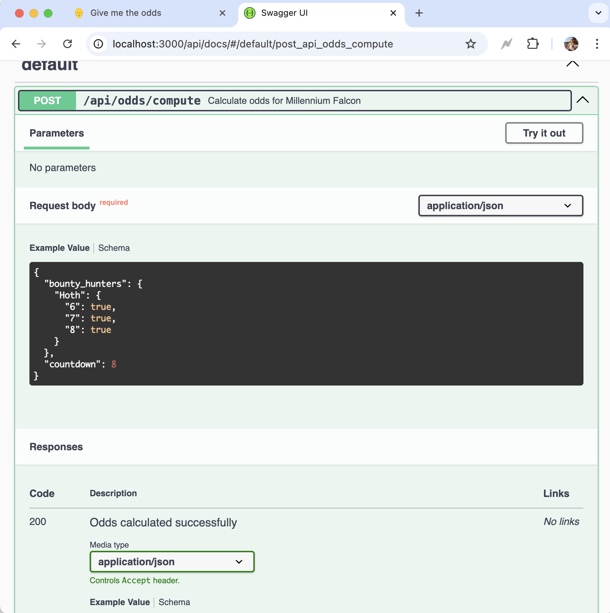

# Millennium falcon challenge solution aka "What are the odds?" from Valeriya

Millenium falcon challenge solution for the problem described on [Developer Technical Test @ Dataiku](https://github.com/dataiku/millenium-falcon-challenge?tab=readme-ov-file)

## Project structure
This project is organized as a **monorepo** using npm workspaces.

- **backend/** - Millennium Falcon onboard computer (Express + Swagger)
- **frontend/** - C3PO web UI (Angular 21)
- **core/** - Shared logic for CLI and backend
- **cli/** - R2D2 command-line interface
- **examples/** - Example input JSON files and Postman collection for backend testing
- **logs/** - Backend logs generated automatically if missing

Everything is written in **TypeScript**, which makes it easier to:
- Maintain a single language across all packages
- Reuse logic and types between backend, CLI, and frontend
- Run, build, and test all parts of the project with unified commands
- Manage dependencies centrally without worrying about mixing technologies

## Technologies & Requirements

It uses the following technologies:
- **Node.js** >= 20
- **npm** >= 11  
- **TypeScript** 5
- **Express** — backend server
- **Swagger UI** — backend API documentation
- **Angular** — frontend web UI
- **Node.js CLI** — CLI tool
- **Vitest** — unit testing  
- **concurrently** — running backend & frontend simultaneously  
- **winston** - Logger lib

Optional tools for development:  
- **Postman** — for testing API endpoints (collection included in `examples/`)

## Getting Started

### Installation

 **Clone** the repository and install dependencies:

```bash
git clone https://github.com/valeriya13/millennium-falcon-challenge.git
cd millennium-falcon-challenge
npm install 
```

 **Build** all packages (CLI, backend, frontend, core):
 
 ```bash
 npm run build
 ```

For CLI usage, **link the CLI package globally**

 ```bash
 npm link
 ```

## Running the project

You can start backend and frontend simultaneously:

```
npm run dev
```

This will start

- Express Backend on <http://localhost:3000>
- Angular Frontend on <http://localhost:4200>
- Swagger UI generated based on BE methods is available on <http://localhost:3000/api/docs>

BE and FE can be also started separately (cf. global package.json)

## Logging
- **Info-level** logs are printed to the console when running the backend.
- **Debug-level** logs are written to files in the logs/ folder.

To change the logging level or configure logging behavior, edit backend/src/utils/logger.ts.

This setup is especially useful when developing in Visual Studio: console logs for quick info, and file logs for detailed debugging.


## Running the CLI Tool

The CLI tool can be run with

```bash
give-me-the-odds examples/example2/millennium-falcon.json examples/example2/empire.json
```

## Examples

All example input files from the challenge are available under the examples/ folder.
You can use them with CLI or via backend API calls (see Postman collection included).

## Testing

Unit tests are implemented for frontend, backend, and core and can be started in one shot 

```bash
npm run test
```

or individually 

```bash
npm run test:backend
npm run test:frontend
npm run test:core
```

The tests cover:
- Core logic correctness
- API responses and error handling
- Frontend rendering and interaction

## Error Handling

- The backend validates input and responds with appropriate error messages
- CLI commands validate input files and report errors if JSON is invalid
- Frontend validates JSON input and shows user-friendly error messages
- Network or server errors are displayed as error messages
- Logs are generated for debugging and stored in logs/ folder

## Screenshots

### App start with npm run dev.
We can see the loaded configuration and links to the servers



### Frontend UI
The frontend starts with a simple welcome screen that includes two buttons and a short guide message inviting the user to upload a configuration file

The design is intentionally minimalistic, functional, and fully responsive.

- The “Compute Odds” button is disabled until a configuration file is uploaded.
- When a file is being uploaded, a loading spinner is displayed.
- The frontend performs basic file format validation before sending any data to the server.



If the file fails validation, an error message is shown and the file is not sent to the backend.


- If the file passes validation, it is sent to the backend API.
- The API returns a computed probability result.
- The UI displays the result using three different colors and messages, depending on the probability (0,100 or medium)

This approach ensures clear user guidance, prevents invalid requests, and provides immediate visual feedback based on the computed outcome.


### CLI

The CLI can be started using the command give-me-the-odds
A built-in help option is available to display basic functionnality and usage instructions



- The CLI can be executed using sample configuration files located in the examples directory. These examples demonstrate the expected configuration format and typical use cases
- The CLI tool operates independently of the backend, it DOESN'T require a running server or any network connection
- All computations are performed using the shared core logic, ensuring consistent results across the CLI and other application layers

This design allows the CLI to be used as a lightweight, standalone utility for local calculations and testing.

### Logs

Backend logs can be viewed either directly in the terminal or in the log file located at logs/onboard_computer.log

- Log files are automatically generated when the backend starts. If the log file does not exist, it is created on startup
- File logs use the DEBUG level for detailed diagnostics. Console logs use the INFO level for cleaner runtime output
- Log levels and behavior are centrally managed via logger.ts in the backend

This setup provides detailed debugging information in files while keeping console output concise and readable

### Postman and swaggerUI 

The backend can be tested and validated using Postman and Swagger UI

A Postman collection named Millenium falcon.postman_collection.json is available in the examples directory.
The collection includes basic usage examples and common error scenarios. 
It can be used to quickly validate API behavior and expected responses.



Swagger UI is automatically generated and started together with the backend.
It is available at the following address: http://localhost:3000/api/docs/#/default/post_api_odds_compute

Swagger UI provides interactive API documentation and allows you to:
- Inspect request and response schemas
- Execute requests directly from the browser
- Validate input and output formats

These tools make it easy to test the backend both manually and interactively during development.




## Author
Valeriya Lebedev — lebedev.valeriya@gmail.com